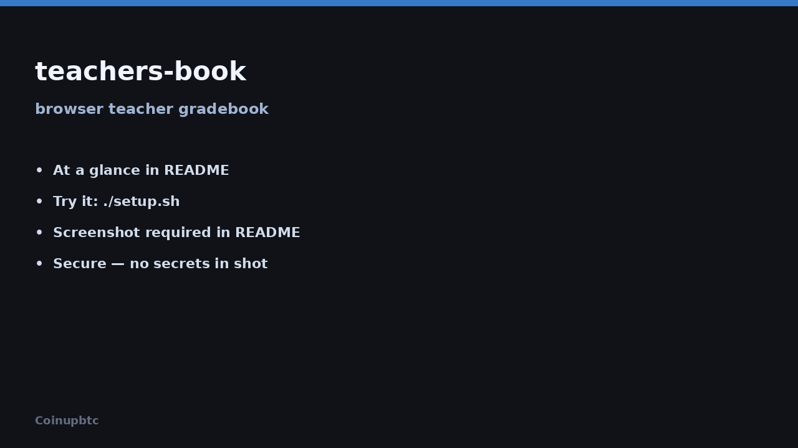

# Teachers B00k — offline gradebook PWA

Open in Chrome, install the app, create an account with your name. Grades stay on that computer.



## At a glance

| | |
|---|---|
| **What it is** | Offline Teachers B00k gradebook (browser PWA). |
| **What it’s for** | Enter and manage class grades on one Windows PC or Chromebook — no cloud login. |
| **How to use it** | Open https://coinupbtc.github.io/teachers-book/ → Install → Create account with your name |

## Try it

1. Open **[https://coinupbtc.github.io/teachers-book/](https://coinupbtc.github.io/teachers-book/)** in Google Chrome  
2. **Install**
   - **Windows Chrome:** menu (⋮) → **Install Teachers B00k…** (or the install icon in the address bar)
   - **Chromebook:** menu → **Install app** / **Add to shelf**
3. Tap **Create account**, enter your name (e.g. Ms. Rivera), then **Create my gradebook**

Next visit: **Sign in** and tap your name. No email, no password.

**Local preview (optional):**

```bash
cd docs
python3 -m http.server 8080
# then open http://127.0.0.1:8080/
```

### Important

- Grades are stored in **this browser on this device** (IndexedDB). They are not uploaded to a server.
- Clearing site/browser data **deletes** your gradebooks. Sign out does **not**.
- There is no multi-device sync — use the same computer/browser to keep your grades.

## Features

| Feature | Teachers B00k |
|---------|---------------|
| Offline / installable PWA | ✅ |
| Name-only local accounts | ✅ |
| Classes + weighted categories | ✅ |
| Gradebook grid (autosave, Enter → next row) | ✅ |
| Batch add students | ✅ |
| Assignments CRUD | ✅ |
| Excused / late / comments | ✅ |
| Class insights + CSV export | ✅ |
| Student Rewards | ✅ |
| IEP Goal Tracker + benchmarks | ✅ |
| Light / dark theme | ✅ |

## Optional: Python local server

Developers who want the older FastAPI + SQLite stack can still run `./setup.sh` or the app under `backend/`. The public product path is the static PWA in `docs/`.
